  

  
  
  

I build open-source infrastructure for AI agents at [@tinyhumansai](https://github.com/tinyhumansai), mostly in Rust. Writing code on GitHub since 2016. This account and [@jainsanil18](https://github.com/jainsanil18) are both me, and the card below counts them as one.

  

### ⚡ What I work on

| | |
|---|---|
| 🐝 **[OpenCompany](https://github.com/tinyhumansai/opencompany)** | Runs a hive mind of agents toward a single goal. My main project: 86 merged PRs. |
| 🧠 **[OpenHuman](https://github.com/tinyhumansai/openhuman)** | A fast, low-cost open-source agent harness (42k★). Core runtime and benchmarks. |
| 📊 **[openhuman-benchmarks](https://github.com/tinyhumansai/openhuman-benchmarks)** | Public evals like Terminal-Bench 2. I find failures caused by the harness, not the model, and fix them. |
| 🦀 **[tinyagents](https://github.com/tinyhumansai/tinyagents)** · **[tinyflows](https://github.com/tinyhumansai/tinyflows)** | A provider-neutral agent harness and agentic workflows, both in Rust. |
| 💾 **[tinymemory](https://github.com/tinyhumansai/tinymemory)** | A common memory interface for agents. I work on recall quality and evals. |

Also: [tinytools](https://github.com/tinyhumansai/tinytools) · [tinyartifacts](https://github.com/tinyhumansai/tinyartifacts) · [tinymcp](https://github.com/tinyhumansai/tinymcp) · [tinysearch](https://github.com/tinyhumansai/tinysearch)

### 🕰️ Previously

- 📡 **[DPSN](https://github.com/DPSN-org)**: real-time data streams for AI agents. I built [deepsense](https://github.com/DPSN-org/deepsense), an agentic LLM orchestration framework that acts on live data, plus the [Node.js SDK](https://github.com/DPSN-org/dpsn-client-nodejs), the [SDK docs](https://github.com/DPSN-org/sdk-docs) and the [agent UI](https://github.com/DPSN-org/ai-agent-ui).
- 🎙️ **[Talker Network](https://github.com/talker-network)**: real-time push-to-talk voice.

### 🛰️ Recently shipped

<!-- RECENT:START -->
- `2026-10-21` **tinyhumansai/openhuman** · [fix(chat): keep live turns visible, and say when a turn is compacting](https://github.com/tinyhumansai/openhuman/pull/8164)
- `2026-10-16` **tinyhumansai/openhuman-benchmarks** · [feat(memory): OpenHuman memory integration arm and LongMemEval_M long-history arms (#38)](https://github.com/tinyhumansai/openhuman-benchmarks/pull/39)
- `2026-10-16` **tinyhumansai/openhuman** · [perf(memory): store past chats with accepted writes](https://github.com/tinyhumansai/openhuman/pull/7961)
- `2026-10-16` **tinyhumansai/openhuman** · [feat(memory): agent memory tool returns capped evidence, pages fetch, and recalls compacted turns](https://github.com/tinyhumansai/openhuman/pull/7840)
- `2026-10-16` **tinyhumansai/openhuman** · [feat(artifacts): versioned artifacts through the tiny-artifacts service , side panel for artifact viewing ,editing and sharing , message rows representing artifacts](https://github.com/tinyhumansai/openhuman/pull/7888)
- `2026-10-16` **tinyhumansai/tinyartifacts** · [Let the host refuse paths inside the file roots](https://github.com/tinyhumansai/tinyartifacts/pull/4)
- `2026-10-16` **tinyhumansai/tinyartifacts** · [Keep a copy of each file version](https://github.com/tinyhumansai/tinyartifacts/pull/3)
- `2026-10-16` **tinyhumansai/tinymemory** · [Evidence recall: a 12 s deadline on the packs, and say when one was left out](https://github.com/tinyhumansai/tinymemory/pull/279)
<!-- RECENT:END -->

### 🔭 Interests

`agent harnesses` · `evals & benchmarks` · `long-running agents` · `agent memory` · `Rust`

The activity card and feed are regenerated daily by <a href=".github/workflows/profile.yml">a GitHub Action</a> from both accounts.
